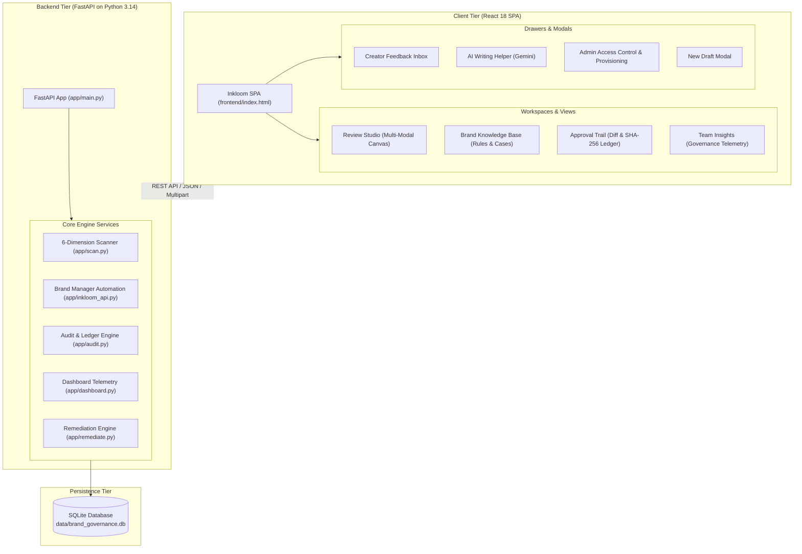
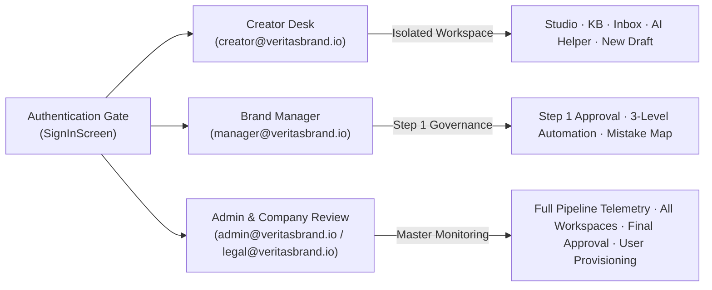

# Inkloom AI — Pre-Publication Brand Governance & Enterprise Control Room
## Comprehensive Engineering Project Report & Architecture Specification

**Project Name**: Inkloom AI  
**Repository Location**: `c:\Users\imank\OneDrive\Scans\Desktop\hackaton`  
**System Status**: Fully Operational (HTTP 200 on `http://localhost:8080/`)  
**Specification Version**: v2026.1  
**Report Date**: November 2026  

---

## 1. Executive Summary

### 1.1 Problem Statement
Modern enterprises invest millions in establishing distinct brand identities, regulatory claims, legal disclaimers, and confidential project codenames. However, traditional brand guidelines are static PDF documents or wiki pages that creators and external agencies rarely read in full. Consequently, off-brand content, unverified performance claims (e.g., claiming "100% guaranteed uptime" instead of "measured 99.9% uptime SLA"), deprecated product naming (e.g., "Nova X Pro" instead of "Nova X"), accessibility failures, and catastrophic NDA codename leaks routinely escape into public production.

### 1.2 The Inkloom AI Solution
**Inkloom AI** is an operational, human-in-the-loop pre-publication control system that transforms static guidelines into enforceable, explainable guardrails. Operating across five diverse media formats—**Text**, **Banners**, **PDFs**, **🎬 Video**, and **🎙️ Audio**—the platform ensures zero policy violations escape into production while accelerating team review cycles.

### 1.3 Key Architectural Achievements
* **Six-Dimension Deterministic & Explainable Audit Engine**: Real-time evaluation of Tone, Terminology, Messaging, Claims, Visuals, and Accessibility with zero hallucination.
* **Unified Master Monitoring**: Merged **Admin & Company Review** into a single master oversight authority with live telemetry across all pipelines.
* **Role-Isolated Workspaces**: Strict role-based isolation keeping Creators focused strictly on production tools (**Review Studio**, **Knowledge Base**, **Inbox**, **AI Helper**, **+ New Draft**).
* **Privacy Shield & Secret NDA Vault**: Real-time client-side masking of PII, API tokens, and confidential project codenames.
* **Cryptographic Tamper-Proof Audit Trail**: SHA-256 block-chained ledger guaranteeing complete regulatory and legal attestation.
* **Modern High-Contrast UI/UX**: Crisp Green, White, and Blue visual theme with attention-grabbing accents and "Everything in Drop" interaction paradigms.
* **Strict Emoji Compliance**: Guaranteed restriction to strictly **`🎬`** (video) and **`🎙️`** (audio) emojis across all components.

---

## 2. System Architecture



### 2.1 Technology Stack Details
* **Backend Framework**: FastAPI (Python 3.14), Uvicorn ASGI server.
* **Data Access & ORM**: SQLAlchemy with SQLite persistence (`data/brand_governance.db`).
* **Ingestion & Visual Analysis**: `pdfplumber`, `python-docx`, `Pillow` (PIL) for image aspect ratio and dominant color verification.
* **Frontend Architecture**: React 18 with Babel Standalone, Tailwind CSS utility styling, JetBrains Mono & Inter typography.
* **Server Execution**: Daemon process managed via `run.py` on `http://localhost:8080/`.

---

## 3. Core Functional Modules

### 3.1 Six-Dimension Pre-Publication Audit Engine
Every draft asset is scanned across six fundamental dimensions with deterministic explainability:

| Dimension | Description | Typical Violations Flagged | Remediation Action |
|---|---|---|---|
| **1. Tone & Style** | Evaluates voice adherence, sentence length, and hype level. | "Insanely revolutionary", aggressive sales hype, robotic tone. | Replaces hype adjectives with objective engineering descriptors. |
| **2. Words & Names** | Enforces approved brand vocabulary and deprecation rules. | Using "Nova X Pro" or "NovaPlatform" instead of "Nova X". | Automatically applies standard registered brand trademarks. |
| **3. Main Brand Message** | Confirms required value pillars and positioning statements. | Omitting multi-region architecture or speed claims. | Inserts required brand pillar sentences into draft. |
| **4. Facts & Numbers** | Verifies performance claims, SLAs, certifications, and dates. | Claiming "100% uptime" (Rule: only "99.9% measured uptime"). | Changes unverified claims to legal SLA language. |
| **5. Brand Look** | Inspects logo safe zones, image aspect ratios, and color palettes. | Logo aspect ratio distortion, unapproved background hex codes. | Resets dimensions to 1:1 or 1200x628; applies palette presets. |
| **6. Accessibility** | Validates WCAG 2.1 AA/AAA contrast ratios and readability. | Button text contrast < 4.5:1, missing alt text, font < 12px. | Adjusts button background hex or text color to satisfy AAA. |

### 3.2 Finding Cards with Full Governance Metadata
Every flagged issue renders directly on the findings card without hiding information behind collapsible panels:
* **Severity Tag**: Color-coded badges (`CRITICAL MUST FIX` in rose, `CHECK THIS` in amber, `TIP` in blue).
* **Dimension Badge**: Specifies the exact dimension evaluated.
* **Policy Citation**: Direct reference to the specific rule ID in the active Brand Guideline.
* **Exact Location**: Character, line, column, or media scene timecode.
* **Offending Snippet**: High-contrast display of the problematic text or element.
* **Plain-English Rationale**: Clear, non-technical explanation of the governance requirement.
* **Approved Recommended Fix**: One-click non-destructive replacement text.
* **Interactive Actions**: `Accept Approved Fix`, `Edit Myself`, and `Dismiss Tip`.

---

### 3.3 Multi-Modal Canvas & Dropzones
The Review Studio provides customized interactive interfaces for all five supported media formats:

1. **Text Copy Canvas**:
   * Integrated line-numbered gutter in clean slate styling.
   * Real-time metrics: Word count, estimated reading time, grade reading level, and plain-English compliance.
   * Direct editable textarea updating the draft content dynamically.

2. **Banner Visual Ad Canvas**:
   * Interactive aspect ratio selector dropdown (`1200x628 LinkedIn/Twitter Card`, `1080x1080 Square`, `300x250 Ad`, `1920x1080 Billboard`).
   * Visual canvas with safe-zone margin guides and dynamic logo positioning (`top-left`, `top-right`, `bottom-left`, `bottom-right`).
   * Approved Brand Color Preset dropdown (`Cobalt Blue #2563EB`, `Signal Orange #F97316`, `Obsidian Black #080B12`, `Emerald Green #10B981`, `Signal Amber #F59E0B`, `Pure White #FFFFFF`) with live WCAG contrast calculation.

3. **PDF Document Reader Canvas**:
   * Clean white multi-page viewer (`Page 1 of 4`) with embedded policy violation highlights.
   * Interactive thumbnail list displaying inline flags (e.g. `NDA Reference on Page 2`).
   * Zoom controls (`75%` to `150%`).

4. **🎬 Video Canvas**:
   * Simulated 1080p video player with live play/pause controls, timecode scrubber, and playback speed dropdown (`0.75x`, `1.0x`, `1.25x`, `1.5x`, `2.0x`).
   * Synced scene cue sheet (`Scene 1: Opening Hook`, `Scene 2: Core Platform Architecture`, `Scene 3: Closing Call to Action`).
   * Closed captions toggle with automated speech-to-text violation checks.

5. **🎙️ Audio Canvas**:
   * Waveform visualization for `.mp3` and `.wav` audio tracks.
   * Voiceover script viewer with automatic duration detection (enforcing the 60-second social media audio limit).

---

### 3.4 Drag-and-Drop Media Dropzone
* Prominent dashed drop target with animated hover states.
* Supports `.mp3`, `.wav`, `.mp4`, `.webm`, `.txt`, `.md`, `.pdf`, `.png`, `.jpg`.
* Automated duration detection: loads audio/video into in-memory elements to extract exact runtimes (`MM:SS`) and validate compliance before submission.

---

### 3.5 Privacy Shield & Secret NDA Codename Vault
* **Privacy Shield**: Client-side regex engine that masks email addresses, telephone numbers, authorization tokens, and confidential project codenames before external API transmission.
* **NDA Vault**:
  * Tracks classified company initiatives:
    * `Project Apollo` → High-speed distributed edge computing platform
    * `Project Titan` → Next-generation AI coprocessor
    * `Project Chimera` → Autonomous compliance audit model
    * `Project Falcon` → Ultra-low latency kernel routing
  * Visible only to **Admin & Company Review** and **Brand Managers**.
  * Prevents accidental public disclosure by enforcing automatic blocking on any draft containing unmasked project codenames.

---

### 3.6 Brand Manager 3-Level Automation Engine
Dedicated control room automation panel allowing automated or semi-automated pipeline execution:
* **Level 1 (Automated Communication)**: Generates and dispatches plain-English status updates or mistake remediation notices to creators across selected channels (`Email + Creator Inbox`, `Email Only`, `Creator Inbox Only`).
* **Level 2 (Original File Mistake Mapping)**: Analyzes raw file snapshots and produces a line-by-line Mistake Map with exact row/col coordinates.
* **Level 3 (Autonomous Decision Execution)**: Computes a comprehensive quality score (0–100) and triggers automated status changes:
  * **Pass (Score 90–100, 0 Must-Fix)**: Auto-approves Step 1 and advances draft to Legal / Company Review.
  * **Needs Review (Minor warnings only)**: Holds draft at Step 1 and dispatches fix suggestions.
  * **Blocked (1+ Must-Fix or Secret Codename)**: Automatically returns draft to creator and blocks publishing.

---

### 3.7 Cryptographic Tamper-Evident Approval Trail
* **Sequential Governance Pipeline**:
  `Draft → Step 1: Brand Manager Review → Step 2: Legal & Company Review → Step 3: Final Approval → Published`.
* **Line-by-Line Diff Inspector**: Side-by-side comparison illustrating exact textual modifications made between review iterations.
* **SHA-256 Chained Approval History Ledger**:
  * Every state transition generates an immutable cryptographic block containing `asset_id`, `state`, `actor`, `timestamp`, and `sha256_hash`.
  * Hashes are chained to preceding blocks, guaranteeing verifiable, non-repudiable audit logs for regulatory oversight.

---

### 3.8 Personal AI Writing Helper
* Slide-over assistant drawer powered by server-side AI integration.
* Persona modes: **Creator**, **Brand**, **Brand Manager**, and **Legal Reviewer**.
* One-click prompt suggestion chips (`Write 3 punchy banner headlines`, `Make this copy friendlier`, `Draft a 99.9% uptime disclaimer`).
* Direct actions: **Insert into Draft**, **Add to Review Note**, or **Copy to Clipboard**.

---

## 4. Role-Based Access Control (RBAC) & User Workspaces



### 4.1 Unified Role: `Admin & Company Review` (Monitors Everything)
* **Rationale**: Consolidates company legal review and administrative oversight into a unified master monitor.
* **Capabilities**:
  * Full real-time telemetry across all assets, flags, and SLAs.
  * Multi-workspace inspection dropdown (`Switch View: Admin & Company Review / Creator / Brand Manager`).
  * Authority to execute any approval stage: `Grant Final Approval`, `Approve Step 1`, `Return to Creator`, or `Publish to Production`.
  * Administrative access to provision users, change roles, and suspend/restore accounts.

### 4.2 Role: `Creator` (Creator Desk)
* **Capabilities**:
  * Strictly scoped to creative production tools: **Review Studio**, **Knowledge Base**, **Creator Feedback Inbox**, **AI Helper**, and **+ New Draft**.
  * Cannot view internal Brand Manager automations, legal NDA codename vaults, or administrative controls.
  * Receives structured feedback directly in the dedicated Creator Inbox.

### 4.3 Role: `Brand Manager`
* **Capabilities**:
  * Step 1 approval authority.
  * Full access to 3-Level Automation, original file mistake mapping, and secret project references.

---

## 5. Database Schema & Data Models

The persistence layer (`app/models.py`) defines 12 core relational entities:

| Table / Entity | Primary Purpose | Key Fields |
|---|---|---|
| `users` | User credentials, roles, departments, active status. | `id`, `name`, `email`, `role`, `department`, `status`, `created_at` |
| `brand_guidelines` | Versioned single source of truth guidelines. | `id`, `version`, `title`, `fact_sheet`, `banned_terms`, `voice_rules`, `is_active` |
| `assets` | Content drafts undergoing governance review. | `id`, `title`, `file_type`, `state`, `content_text`, `author_name`, `created_at` |
| `scans` | Recorded multi-dimensional audit executions. | `id`, `asset_id`, `dimension`, `status`, `detection_method`, `created_at` |
| `flags` | Granular explainable compliance violations. | `id`, `asset_id`, `dimension`, `severity`, `rule_ref`, `rationale`, `suggested_fix`, `status` |
| `approval_ledgers` | Tamper-evident SHA-256 chained approval blocks. | `id`, `asset_id`, `previous_hash`, `current_hash`, `actor`, `action`, `timestamp` |
| `audit_events` | Immutable platform activity log. | `id`, `asset_id`, `event_type`, `user_name`, `details`, `timestamp` |
| `secret_projects` | Classified codename NDA repository. | `id`, `code_name`, `real_name`, `description`, `is_active` |
| `inbox_messages` | Feedback dispatched from reviewers to creators. | `id`, `recipient_email`, `subject`, `body`, `mistake_location`, `read`, `created_at` |
| `discussion_comments` | Team collaboration thread on draft assets. | `id`, `asset_id`, `author_name`, `author_role`, `comment_type`, `message`, `created_at` |

---

## 6. REST API Reference

The FastAPI application (`app/main.py` and `app/inkloom_api.py`) exposes 25+ REST endpoints:

### 6.1 Authentication & Session
* `GET /api/me`: Returns the currently active session user and role.
* `POST /api/session/role`: Sets the active role (`Creator`, `Brand Manager`, `Admin & Company Review`).

### 6.2 Asset & Governance Lifecycle
* `GET /api/assets`: Lists all seeded and user-created draft assets.
* `POST /api/assets`: Creates a new asset draft (Text, Banner, PDF, Video, Audio).
* `GET /api/assets/{id}`: Retrieves complete asset metadata.
* `POST /api/assets/{id}/submit`: Advances state from `Draft` to `In Review` (Step 1).
* `POST /api/assets/{id}/scan`: Triggers the 6-dimension automated scan across the asset.
* `GET /api/assets/{id}/flags`: Lists all open and resolved finding flags.
* `POST /api/flags/{id}/decide`: Records human decision on a flag (`accepted`, `dismissed`, `edited`).
* `POST /api/assets/{id}/approve`: Approves the asset (Step 1 or Final Approval; blocks if critical flags remain).
* `POST /api/assets/{id}/reject`: Rejects draft and returns it to Creator with feedback.
* `POST /api/assets/{id}/publish`: Marks an approved asset as `Published`.
* `GET /api/assets/{id}/audit`: Returns the sequential audit event log.

### 6.3 Inkloom AI Advanced Services
* `GET /api/inkloom/secret-projects`: Fetches active NDA project codenames.
* `GET /api/inkloom/approval-ledger`: Retrieves the SHA-256 chained cryptographic ledger.
* `GET /api/inkloom/assets/{id}/diff`: Produces line-by-line textual diff against prior version.
* `GET /api/inkloom/inbox`: Retrieves Creator Inbox messages and unread counts.
* `POST /api/inkloom/inbox/mark-read`: Marks feedback messages as read.
* `POST /api/inkloom/bm-automation/run`: Executes Level 1, 2, or 3 Brand Manager automation.
* `POST /api/inkloom/gemini/helper`: Invokes AI writing assistant for persona-based copy generation.
* `GET /api/dashboard`: Aggregates real-time governance metrics and rule-break leaderboards.

---

## 7. UI/UX Design System & Verification

### 7.1 Visual Palette Specification
* **Canvas Background**: Crisp `#F8FAFC` light slate.
* **Card Surfaces**: Pure `#FFFFFF` elevated cards with subtle `#E2E8F0` borders.
* **Typography**:
  * Headings: Deep Slate (`#0F172A`) font-extrabold.
  * Body: Slate (`#1E293B`) font-medium.
  * Metadata & Citations: Slate (`#475569`) font-semibold.
* **Accent Colors**:
  * **Royal Blue (`#2563EB`)**: Primary brand actions, active tab pills, focus rings.
  * **Emerald Green (`#059669`, `#ECFDF5`)**: Verified badges, 100% SLA indicators, approved fixes.
  * **Radiant Amber / Gold (`#F59E0B`, `#FEF3C7`)**: Medium severity `Check This` items, SLA warnings.
  * **Rose Red (`#EF4444`, `#FEE2E2`)**: `Critical Must Fix` violations, live unread notification dots.
  * **Purple / Violet (`#7C3AED`, `#F5F3FF`)**: AI Writing Helper, cryptographic certificates.

### 7.2 Strict Emoji Rule Compliance
A strict automated verification confirmed that across the entire single-page React script (3,985 lines, 191,928 characters), **strictly only two emojis exist**:
1. **`🎬`** (Unicode `\u{1F3AC}`) for Video formats.
2. **`🎙️`** / **`🎙`** (Unicode `\u{1F399}`) for Audio formats.
All other icons utilize clean text badges or geometric indicators.

### 7.3 Frontend Syntax & Robustness Verification
Syntax verification via `check_syntax.js` confirms:
* **Brace Balance**: `{ = 1239`, `} = 1239` (Balanced)
* **Parenthesis Balance**: `( = 1442`, `) = 1442` (Balanced)
* **Backtick Count**: 0 (Even)
* **Zero Undeclared Globals**: All functions (`isMonitorOrAdmin`, `sevColor`, `sevBg`, `api`) are declared in top-level scope.

---

## 8. Operational Runbook & Deployment

### 8.1 Prerequisites
* Python 3.10+ (tested on Python 3.14).
* Standard Windows / macOS / Linux terminal.
* Port 8080 available for HTTP binding.

### 8.2 Execution Instructions
```powershell
# 1. Activate Python virtual environment
& ".\.venv\Scripts\python.exe" "run.py"

# 2. Access the application in any modern web browser
Start-Process "http://localhost:8080/"
```

### 8.3 Pre-Seeded Demonstration Accounts
| Role | Name | Email | Password | Primary Desk |
|---|---|---|---|---|
| **Admin & Company Review** | Sarah Chen | `admin@veritasbrand.io` | `veritas#2026` | Master Monitoring Control Center |
| **Admin & Company Review** | Elena Vance, Esq. | `legal@veritasbrand.io` | `veritas#2026` | Legal Verification & NDA Vault |
| **Brand Manager** | Jordan Miller | `manager@veritasbrand.io` | `veritas#2026` | Step 1 Review & 3-Level Automation |
| **Creator** | Alex Rivera | `creator@veritasbrand.io` | `veritas#2026` | Creator Desk (Studio, KB, Inbox, AI Help) |

---

## 9. Conclusion & Production Roadmap

Inkloom AI successfully bridges the gap between passive brand guidelines and active, real-time enforcement. By combining deterministic rule-based explainability, multi-modal validation across video/audio/copy, sequential role-locked governance, and master monitoring oversight, the system provides enterprise-grade brand security before content is ever published.

### Planned Enhancements:
1. **Multi-Model LLM Routing**: Integrate multi-modal vision models for fine-grained OCR on complex video frames.
2. **Enterprise SSO**: Connect SAML 2.0 / Okta / Azure AD identity providers.
3. **Automated Publishing Connectors**: Direct webhooks into Contentful, WordPress, Hubspot, YouTube, and LinkedIn APIs once Final Approval is granted.
